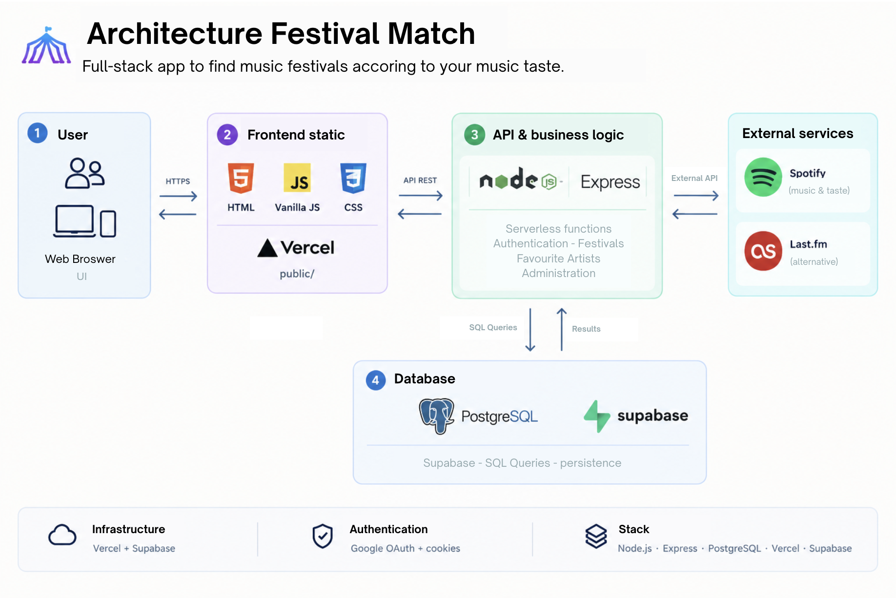
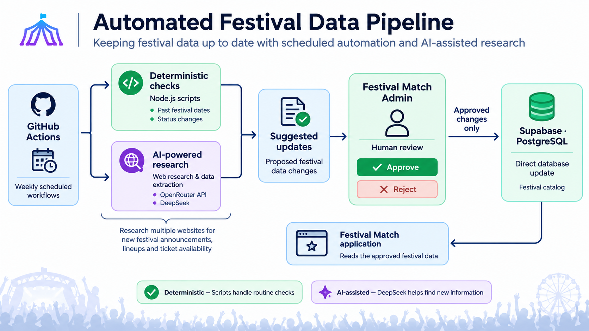

# Festival Match

**Match your music taste against real festival lineups.**

Live: https://festivalmatch.vercel.app/ · Español: [README_es.md](README_es.md)

Add the artists you actually listen to. Festival Match compares your list against
the lineup of every festival in its catalogue and scores each one — so instead of
"what's on in Europe this summer" you get "which of these festivals is actually
about you".

## What it does

- **Match score** — the share of your artists that appear in each lineup, ranked best first.
- **63 festivals, 900+ announced artists** across the 2026 and 2027 seasons in Europe, the USA
  and Latin America. Lineups are flagged as *confirmed*, *partial* or *unannounced*, so you
  know how much to trust a score.
- **Build your library your way** — connect [Spotify](https://spotify.com) to pull your top
  artists, import from [Last.fm](https://last.fm), search via [MusicBrainz](https://musicbrainz.org),
  or add them by hand.
- **Demo mode** — try the whole flow before creating an account.
- **Three languages** — English, Spanish and Finnish.
- **Admin panel** — approve AI-extracted lineups and festival-date proposals, rotate past
  editions, and review user-suggested festivals. Nothing reaches the public catalogue without
  human approval.

## Stack

| Layer | Choice |
|---|---|
| Backend | Node.js + Express 4 (CommonJS) |
| Frontend | Vanilla JS + CSS — **no build step, no framework, no bundler** |
| Database | PostgreSQL on Supabase, through `pg` (raw SQL, no ORM) |
| Auth | Google OAuth, bcrypt, cookie sessions |
| Automation | GitHub Actions — weekly source scan, LLM extraction, admin approval |
| Hosting | Vercel (serverless functions) + Supabase |

## Architecture




## Automated data pipeline



A GitHub Actions workflow runs every Monday. It revisits the official site of every festival that
is due for a check, extracts the visible text and hashes it, so unrelated markup changes don't
count as news. When the hash changes, an LLM (DeepSeek through OpenRouter) turns the page into
strict JSON: artists, lineup status, announcement date, ticket status and the evidence it used.

The result is **never published automatically**. It lands in a proposal table and I approve or
reject it from the admin panel, which publishes inside a transaction and supersedes the previous
proposal. The fetcher is HTTPS-only with pinned DNS, validates every redirect, caps response
size and concurrency, and backs off on failures. Confirmed lineups are not rechecked until
after the edition.

## Three decisions worth explaining

**The frontend calls relative URLs.** Everything is `fetch('/api/...')`, with no domain
hardcoded anywhere. Because the API and the frontend share the same Vercel domain, there
is no CORS to configure and cookies work without a single line of extra code. Local,
preview and production behave identically.

**No build step.** `public/` is served exactly as it is on disk. The entire client is
~3,000 lines of vanilla JS you can read in one sitting, and there is no toolchain to
install, version or break.

**The Postgres pool is tuned for serverless.** `max: 1`, explicit connect and idle
timeouts, and a `pool.on('error')` handler. Each Vercel instance handles concurrent
requests but should hold a single connection, because Supabase's pooler multiplexes the
real ones. The error handler is the important one: without a listener, an `'error'` from
the pool is an uncaught throw that takes the instance down.

One trap that cost me an afternoon, in case it saves you one: the connection string must
**not** include `?sslmode=require`. With `pg` 8.16 that parameter resolves to
`rejectUnauthorized: true`, and because the string is parsed *after* the config object it
overrides the pool's own `ssl` — every query then fails with *self-signed certificate in
certificate chain*. The TLS settings live in `server/db.js`, not in the URL.

## Layout

```
app.js               # Express entrypoint — this is what Vercel deploys
server/server.js     # All routes: auth, API, admin
server/db.js         # Postgres pool, queries
server/auth.js       # Google OAuth
migrations/          # Schema, applied once instead of on every boot
public/              # The entire frontend
```

## Status

Live on Vercel, with Supabase as the database. Accounts, favourites, genres and artist
libraries all work.

One honest note:

- **Google shows an "app not verified" screen** before the login button. That is what
  happens to any app that has not gone through Google's verification process, and
  verification is not worth paying for on a project like this. Click
  *Advanced → Go to Festival Match* and it lets you through.

---

Built by [Nelson Cabrera](https://github.com/nelsoncabrera06).
